# 多平台电商存量经营分析报告

- **业务对象**：同时运营淘宝、京东、抖音三个渠道的电商业务
- **数据窗口**：2025-01-01 ~ 2026-12-28（统计快照日 2026-12-31）
- **数据规模**：用户 5,486 人、商品 3,298 个 SKU、行为日志 21,998 条、订单 10,996 笔、订单明细 27,523 行
- **分析主线**：数据质量校验 → 多表关联与基础指标 → 漏斗诊断 → Cohort/RFM 生命周期 → 帕累托与商品分层 → EDA 特征洞察 → BI 看板 → 经营建议
- **技术边界**：不做 PCA/K-Means 聚类、不做 A/B 实验；机器学习仅用一次默认参数逻辑回归做下单转化的特征方向验证（训练集 AUC = 0.78，另附 5 组基线对照（仅人口属性 0.5124 / 仅平台 0.5429 / 仅意图两特征 0.7702 / 全集 0.7766 / 去掉意图 0.6492），只取系数方向交叉印证，不用于预测上线）；附录 C/D 对相关字段使用卡方/Spearman **观察性独立性检验**（无实验分组，结论仅限"字段间是否存在统计关联"，不做因果解读）；核心指标以 SQL（CTE+窗口函数）为准，pandas 与 Excel 做交叉复核
- **核心口径**：有效订单 = `order_status='已完成'`；GMV = 有效订单 `total_amount` 之和 = **5,692,092.13 元**

---

## 阶段 1：数据质量校验与基础指标

### 1.1 数据质量报告片段

#### 1.1.1 缺失值检查（9 张业务表逐字段）

逐字段扫描后，除下表列出的 4 个字段外，**其余所有字段缺失数均为 0**（含全部主键、全部外键、时间、金额字段）。

| 表 | 字段 | 缺失数 | 占比 | 性质判断 | 处理选择与理由 |
|---|---|---:|---:|---|---|
| product | tags | 3,298 | **100.00%** | 整列无效，无任何信息 | **不填充不使用**：整列缺失无法提供分析价值，全程剔除出特征集 |
| user_behavior | app_version | 21,998 | **100.00%** | 整列无效 | 同上，不纳入分析 |
| user_behavior | referrer | 7,158 | 32.54% | 业务性缺失：直接访问/无来源页 | **标记保留**：以「未知来源」归类，不删除行为记录、不臆造填充。该字段实际只有 3 类取值（`https://m.jd.com` 7,465 条 / `https://m.taobao.com` 7,375 条 / 空值 7,158 条），与 platform 字段高度重合、无独立渠道信息，故**未做来源渠道分析** |
| order | coupon_code | 5,520 | 50.20% | 业务性缺失：该单未使用优惠券 | **标记保留**：空值即「无优惠券」，与 promotion_id 联动做促销结构分析，属于正常业务形态而非错误 |

#### 1.1.2 主键重复与完全重复行检查

| 检查项 | 结果 |
|---|---|
| 9 张表主键重复（platform.code、user.global_user_id、product.global_product_id、behavior_id、order_id、order_item_id 等） | **0 条** |
| 5 张业务主表完全重复行（user / product / user_behavior / order / order_item） | **0 条** |

结论：主键唯一性全部合格，无需去重。

#### 1.1.3 外键完整性检查

| 外键关系 | 子表记录数 | 主表匹配不上的孤儿记录数 | 结果 |
|---|---:|---:|---|
| user_behavior.global_user_id → user | 21,998 | **0** | 通过 |
| user_behavior.global_product_id → product | 21,998 | **0** | 通过 |
| order.global_user_id → user | 10,996 | **0** | 通过 |
| order_item.order_id → order | 27,523 | **0** | 通过 |
| order_item.global_product_id → product | 27,523 | **0** | 通过 |

结论：参照完整性 100%，多表 JOIN 不存在因孤儿 ID 丢行的风险。

#### 1.1.4 业务逻辑异常检测

> 严格遵循「先统计、后给方案、不盲目删除」原则，每类异常给出两种可选处理并记录最终选择与理由。

**异常台账（异常类型 - 异常样本数量 - 占比 - 处理选择 - 选择理由）**

| # | 异常类型 | 异常样本数量 | 占比 | 可选处理 | 最终选择与理由 |
|---|---|---:|---:|---|---|
| 1 | **订单时间早于用户注册日期**（order_time < registration_date） | 5,499 笔订单 | 占全部订单 **50.01%** | ①标记保留，时间分析中剔除负向时间差；②直接删除 | **选①标记保留**。删除将损失一半样本且破坏平台/等级结构；该问题为注册日期与订单日期独立随机所致。处理：Cohort 中注册前订单 offset 为负，**不计入任何留存窗口**；RFM 与 GMV 不依赖注册日期故不受影响；报告对留存结论做低置信标注 |
| 2 | **行为时间早于注册日期**（behavior_time < registration_date） | 11,046 条行为 | 占全部行为 **50.21%** | ①标记保留；②删除 | **选①标记保留**，理由同上；漏斗只按行为类型做去重用户统计，不使用注册日期，结论不受影响 |
| 3 | **用户×商品粒度「下单」早于「浏览」**（同一 user+product 最早下单时间 < 最早浏览时间） | **12 对**（涉及 27 条行为、12 名用户、12 个商品） | 占有浏览+下单双行为的 1,087 对用户商品的 **1.10%** | ①标记保留；②删除异常会话 | **选①标记保留**。占比极低且为日志乱序，删除会改变真实用户行为基数；漏斗按「环节去重用户」独立统计，不依赖同用户同商品先后顺序，指标不受影响；仅在严格路径分析场景提示 |
| 4 | **同一会话被多个用户共用（疑似串号）** | **2 个 session_id** | 占 21,996 个会话的 **0.009%** | ①标记保留；②删除会话 | **选①标记保留**。量级可忽略；漏斗以 global_user_id 去重，串号会话不产生重复用户计数 |
| 5 | 订单 total_amount 为负 / 为零 | 0 / 0 | 0% | — | 未检出，无需处理（金额区间 100.01~4,999.67） |
| 6 | discount_amount 为负 | 0 | 0% | — | 未检出（区间 0.01~1,492.94） |
| 7 | payment_time 早于 order_time | 0 | 0% | — | 未检出（支付滞后均为 5~60 分钟，中位数 33 分钟） |
| 8 | order_item.quantity ≤ 0 | 0 | 0% | — | 未检出（数据中数量恒为 1） |
| 9 | order_item.item_total 为负 | 0 | 0% | — | 未检出 |
| 10 | item_total ≠ quantity × unit_price（容差 0.02 元） | 0 | 0% | — | 未检出，27,523 行全部精确勾稽 |

> 对提示词点名的「同一 session_id 下单时间早于浏览」补充说明：本数据集 99.99% 的会话仅含 1 条行为（21,994/21,996），会话内不存在浏览+下单共存样本，**会话粒度检出 0 例**；时序颠倒真实存在于「用户×商品」粒度（12 对，见异常 #3），已按上表处理。两种粒度的检出数均如实披露。

#### 1.1.5 字典编码合法性与口径性问题

| 检查项 | 结果 | 处理 |
|---|---|---|
| 订单 platform 编码在 platform 字典的命中率 | 10,996/10,996（taobao、jd、douyin），**非法 0 条** | 正常 LEFT JOIN |
| order_status / payment_method / shipping_method 中文名命中率 | 非法均为 **0 条** | 订单表按字典 **name** 列关联（非 code 列） |
| platform 字典存在无业务数据的编码 | pinduoduo、tiktok_shop 共 2 个 | 保留字典不删除，统计范围限定实际有单的三平台 |
| shipping_method 字典重名 | local、same_city 两个 code 同名「同城配送」 | 关联前按 name 去重（MIN(code)），避免一对多 JOIN 导致订单金额翻倍 |
| payment_time 全量非空（待付款 2,224 笔、已取消 2,177 笔也有支付时间） | 4,401 笔「逻辑上不该有支付时间」的订单存在时间戳 | 视为数据生成痕迹；**判定是否支付以行为表「支付」事件与 order_status 为准，不以 payment_time 非空为准**，行保留 |
| total_amount 与明细合计 | 10,996/10,996 订单恒等（差额 0 元），discount/shipping_fee/tax_amount 未参与扣减 | GMV 以 total_amount 为准；优惠/运费/税费仅作结构字段，不做加减项 |
| 单一取值/全空字段 | stock_status 全为「有货」、subcategory 全为「其他」、device_type 全为 mobile、latitude/longitude 全为 0、extra_data 全为 `{}` | 设备影响、库存深度、子品类、地域经纬度分析**不具备数据条件**，在结论与局限性中明确披露 |

### 1.2 多表关联方案

- 关联路径：`user 1—N order 1—N order_item N—1 product N—1 平台/品类`，`user 1—N user_behavior N—1 product`，四张字典表编码/名称补中文名。
- 全部关联 SQL（含三个宽表视图 `v_order_enriched / v_item_wide / v_behavior_wide`）落地在 `code/data_process.sql`，以 CTE 组织；pandas merge 备选实现见 `code/analysis_pipeline.ipynb`。
- 数据质量 SQL 复核（外键、金额、时序、字典 5 个 `dq_*` 分段）与 pandas 结果逐项一致。

### 1.3 全局与分平台核心指标（SQL 计算，已完成订单口径）

| 平台 | GMV（元） | GMV 占比 | 有效订单量 | 有效购买用户 | 客单价（元） |
|---|---:|---:|---:|---:|---:|
| **全网** | **5,692,092.13** | 100% | **2,216** | **1,643** | **2,568.63** |
| 淘宝 | 2,322,985.63 | 40.81% | 912 | 630 | 2,547.13 |
| 抖音 | 1,752,679.64 | 30.79% | 673 | 569 | 2,604.28 |
| 京东 | 1,616,426.86 | 28.40% | 631 | 444 | 2,561.69 |

**业务解读**：淘宝为基本盘（四成 GMV）；抖音订单量与客单价均不弱（客单价三平台最高），GMV 差距主要来自转化而非客单；三平台客单价极差仅 57 元（±2.3% 以内），价格带定位趋同。

### 1.4 浏览→加购→下单→支付全链路漏斗

**全网漏斗（去重用户）**

| 环节 | 用户数 | 环节转化率 | 相对浏览累计转化率 |
|---|---:|---:|---:|
| 浏览 | 2,711 | — | 100% |
| 加购 | 2,368 | **87.35%** | 87.35% |
| 下单 | 1,953 | **82.47%** ← 全网最大卡点 | 72.04% |
| 支付 | 1,734 | 88.79% | **63.96%** |

**分平台漏斗**

| 平台 | 浏览 | 浏览→加购 | 加购→下单 | 下单→支付 | 浏览→支付 |
|---|---:|---:|---:|---:|---:|
| 淘宝 | 845 | 88.40% | 83.27% | 86.50% | 63.67% |
| 京东 | 742 | **94.74%** | **94.03%** | **93.34%** | **83.15%** |
| 抖音 | **1,124** | 81.67% | **72.98%（最低）** | 86.42% | 51.51% |

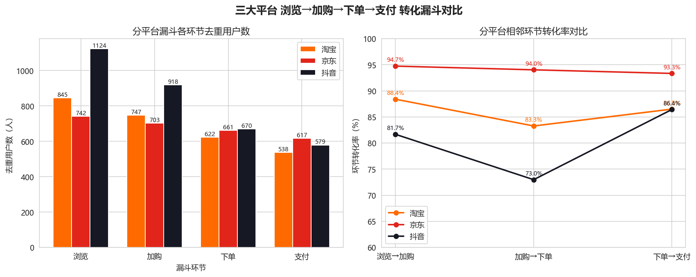

**业务解读**：
1. **抖音「拿着最多的流量，交出最低的转化」**：浏览用户 1,124 人（占三平台浏览总量 41.46%），但浏览→支付仅 51.51%，比京东低 31.64 个百分点；加购→下单环节流失 248 人，占三平台该环节总流失（415 人）的 **59.8%**，是最明确的运营干预靶点。
2. **京东是「小而美」的高效渠道**：浏览基数最小（742 人），但每一段转化率都在 93% 以上，流量利用效率最高，短板在流量规模。
3. 淘宝指标居中、体量最大，下单→支付（86.50%）仍比京东低 6.84pp，支付收尾环节有优化空间。
4. 口径提示：行为日志为独立采样，各环节用户集合非严格包含（628 人有加购无浏览记录等），漏斗采用标准「环节去重用户」口径，已在指标字典披露；严格路径口径（要求环节嵌套）的对照结果见附录 B。

**口径衔接（行为表「下单」≠ 订单表「下单」）**：本节的漏斗取自行为日志 `user_behavior`，而 1.3 的 GMV 与有效购买用户取自交易表 `order`，两套「下单」不是同一件事，差异已量化并落盘 `output/metrics/behavior_order_overlap.csv`：

| 范围 | 行为表「下单」用户 | 订单表任意状态用户 | 订单表已完成用户 | 行为∩任意状态 | 行为∩已完成 | 仅有行为、无订单 | 有订单、无下单行为 |
|---|---:|---:|---:|---:|---:|---:|---:|
| 全网 | 1,953 | 4,215 | 1,643 | 1,551（79.42%） | 640（32.77%） | 402 | 2,664 |
| 淘宝 | 622 | 1,301 | 630 | 562（90.35%） | 284（45.66%） | 60 | 739 |
| 京东 | 661 | 1,217 | 444 | 523（79.12%） | 193（29.20%） | 138 | 694 |
| 抖音 | 670 | 1,697 | 569 | 466（69.55%） | 163（24.33%） | 204 | 1,231 |

**读法**：① 漏斗环节转化率（1.4 节）用于定位**行为链路**上的卡点，有效购买用户与 GMV（1.3、2.6 节）用于衡量**交易结果**，两者不可互相换算，也不能用行为表的下单用户数替代购买用户数；② 抖音的行为下单用户（670 人）与订单表已完成购买用户（569 人）仅 163 人重叠（24.33%），这与行为日志独立采样（99.99% 的会话仅 1 条行为，21,994/21,996）一致，是数据特征而非业务结论；③ 全网 402 人有「下单」行为却在订单表查无任何订单，同样源于两份数据独立生成。

### 1.5 会员等级 GMV 贡献

| 会员等级 | 有效订单量 | 购买用户数 | GMV（元） | GMV 占比 | 客单价（元） |
|---|---:|---:|---:|---:|---:|
| 钻石会员 | 604 | 427 | 1,570,928.82 | 27.60% | 2,600.88 |
| 普通会员 | 559 | 416 | 1,451,632.34 | 25.50% | 2,596.84 |
| 银卡会员 | 539 | 423 | 1,372,368.82 | 24.11% | 2,546.14 |
| 金卡会员 | 514 | 377 | 1,297,162.15 | 22.79% | 2,523.66 |

**业务解读**：四个等级 GMV 占比落在 22.79%~27.60% 的窄区间，最高与最低仅差 4.81pp；客单价极差仅 77 元（3.1%）。**现有会员等级没有体现出明显的消费分层差异**，等级权益对消费的撬动作用在数据中不可见，会员体系需要重新设计权益梯度。

### 1.6 一级品类销售

| 品类 | GMV（万元） | 有效订单量 | 动销 SKU 数 |
|---|---:|---:|---:|
| 食品饮料 | 77.74 | 694 | 269 |
| 家居用品 | 75.24 | 660 | 252 |
| 图书文具 | 74.52 | 662 | 266 |
| 母婴用品 | 74.06 | 649 | 264 |
| 电子产品 | 68.45 | 624 | 247 |
| 服装鞋帽 | 67.65 | 607 | 239 |
| 运动户外 | 67.07 | 593 | 256 |
| 美妆个护 | 64.48 | 579 | 250 |

**业务解读**：品类盘子均衡，头部（食品饮料）与尾部（美妆个护）GMV 差距仅 20.6%，无明显依赖单一品类的结构性风险；结合下一阶段品类转化率看，**「卖得多」与「转化高」并不重合**——食品饮料靠流量，运动户外靠转化效率。

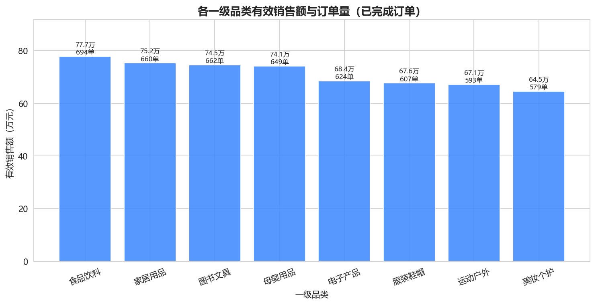

---

## 阶段 2：用户生命周期与经营统计分析

### 2.1 Cohort 同期群留存（SQL 窗口：julianday 日期差 + 批次聚合）

以注册月份分 24 个批次，统计注册后 30/60/90 天内再次产生已完成订单的比例。对 90 天窗口完整的 21 个批次取平均：

| 留存窗口 | 完整批次平均留存率 | 区间 |
|---|---:|---|
| 30 天 | **1.78%** | 0.43% ~ 3.90% |
| 60 天 | **3.22%** | 1.65% ~ 6.06% |
| 90 天 | **4.66%** | 1.90% ~ 7.36% |

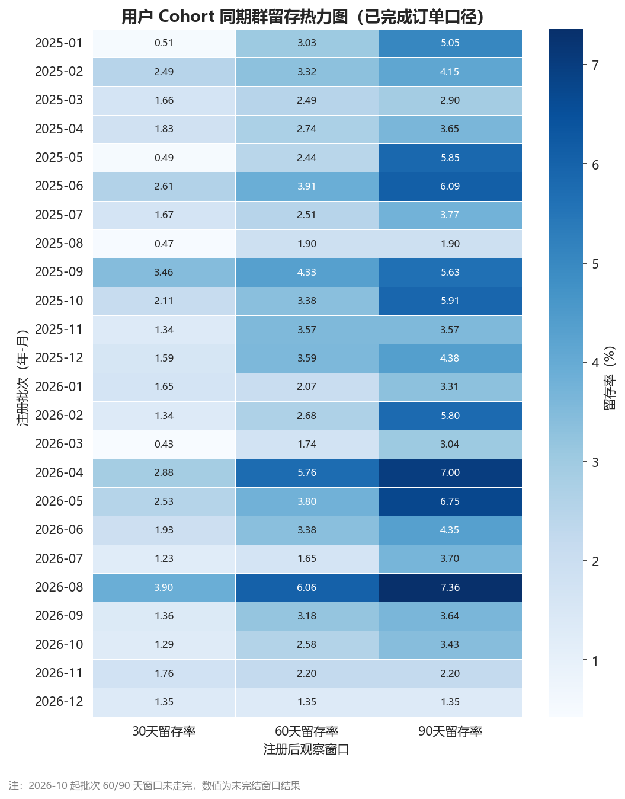

**业务解读与置信度**：留存绝对水平极低且没有随批次改善的趋势，表明业务几乎是「一次性买卖」，缺少复购引擎。该结论为 **[中置信度]**：数据中 50.01% 订单早于注册日期（异常 #1），负 offset 订单不计入留存，可能低估真实复购；但即使把口径放宽（附录 A：注册前订单全部计入时 30/60/90 天为 15.29%/16.49%/17.70%），量级上仍属极低水平。2026-10 起批次 60/90 天窗口未走完，图中已标注，不参与均值计算。

### 2.2 RFM 用户分层（SQL：NTILE(4) 窗口打分 + CASE 规则分层）

打分口径：R 按距今天数降序分桶（越近分越高），F、M 按升序分桶（频次/金额越高分越高）。分层覆盖 1,643 名有效消费用户；另有 3,843 名注册用户无有效订单，不强行打分，作为「无有效消费人群」单独披露（占注册用户 70.05%）。

| 用户分层 | 人数 | 人数占比 | GMV（万元） | GMV 占比 | 平均 R（天） | 平均 F | 人均 M（元） |
|---|---:|---:|---:|---:|---:|---:|---:|
| 高价值用户 | 434 | 26.42% | 264.58 | **46.48%** | 136.5 | 1.97 | 6,096.37 |
| 流失预警用户 | 380 | 23.13% | 170.81 | **30.01%** | 504.5 | 1.30 | 4,495.03 |
| 低价值用户 | 442 | 26.90% | 69.63 | 12.23% | 517.1 | 1.00 | 1,575.38 |
| 潜力用户 | 387 | 23.55% | 64.18 | 11.28% | 150.4 | 1.09 | 1,658.50 |

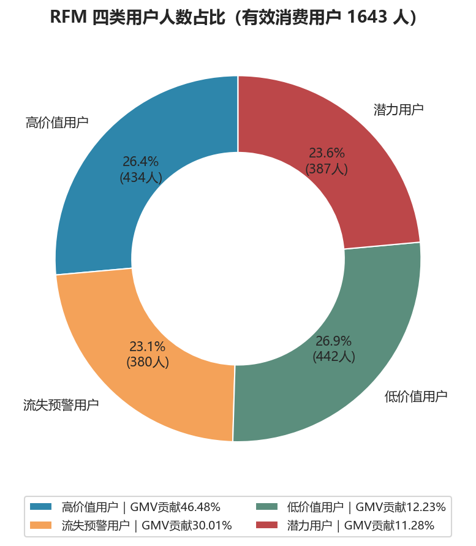

**业务解读**：
1. **高价值 + 流失预警两类用户合计 814 人（49.54%），贡献 76.49% 的 GMV**，经营资源应高度聚焦这一半用户。
2. **流失预警是最紧迫的召回池**：380 人承载 30.01% GMV、人均累计消费 4,495 元，却已平均 504.5 天未下单——历史高价值正在沉默。
3. 潜力用户「近期还活跃（R≈150 天内有单）但频次低、金额低」，是做提频、升单的最佳试验田。
4. 低价值用户全部 F=1，适合低成本内容触达，不应投入高成本补贴。

### 2.3 帕累托 80-20 分析

| 维度 | 头部 20% 规模 | 贡献 GMV 占比 |
|---|---:|---:|
| 用户（329 人 / 1,643 人） | 329 人 | **43.40%** |
| 动销 SKU（409 个 / 2,043 个） | 409 个 | **47.63%** |

**业务解读**：两端集中度均显著低于经典「80/20」——用户消费与商品销售都偏分散。含义有两面：① 没有对少数大客户/大单品形成危险依赖，抗风险能力强；② 头部经营尚有空间，资源聚焦的边际收益高（把头部 20% 用户的贡献从 43% 向 55%+ 拉升，比普惠补贴更高效）。

**累计贡献曲线（CUME_DIST 口径）**：另按名次分位（`CUME_DIST()`）计算累计贡献曲线，落盘 `output/metrics/pareto_cumulative.csv`，图见 fig17：

| 头部累计人数占比 | 用户：累计 GMV 占比 | SKU：累计 GMV 占比 |
|---:|---:|---:|
| 10% | 28.57% | 29.03% |
| 20% | **43.32%** | **47.55%** |
| 30% | 56.06% | 61.47% |
| 50% | 77.11% | 80.96% |
| 100% | 100.00% | 100.00% |

**两套头部口径不可混用（易错点）**：本节表格的「头部 20%」由 `NTILE(5)` 第 1 桶定义（用户 329 人）；累计曲线由 `CUME_DIST() <= 0.2` 定义（用户 328 人）。差异来自 NTILE 把余数分配给前面的桶（1,643 = 5×328 + 3，前 3 桶各 329 人），因此 **43.40%（NTILE）与 43.32%（CUME_DIST）是同一批数据的两套切分，不是计算误差**；SKU 侧同理（409 个 / 47.63% 与 408 个 / 47.55%）。两口径指向同一结论：集中度均低于经典 80/20。

### 2.4 商品分层：爆品、动销、滞销（SQL：LEFT JOIN 保全部 SKU + NTILE(5) + 库存标记）

| 分层 | 定义 | SKU 数 | SKU 占比 | GMV 贡献 |
|---|---|---:|---:|---:|
| 爆品 SKU | 动销 SKU 中有效销售额前 20% 且有货 | **409** | 12.40% | **47.63%**（271.11 万元） |
| 动销 SKU | 其余有有效成交 SKU | 1,634 | 49.55% | 52.37% |
| 滞销 SKU | 窗口内无有效成交 | **1,255** | **38.05%** | 0% |

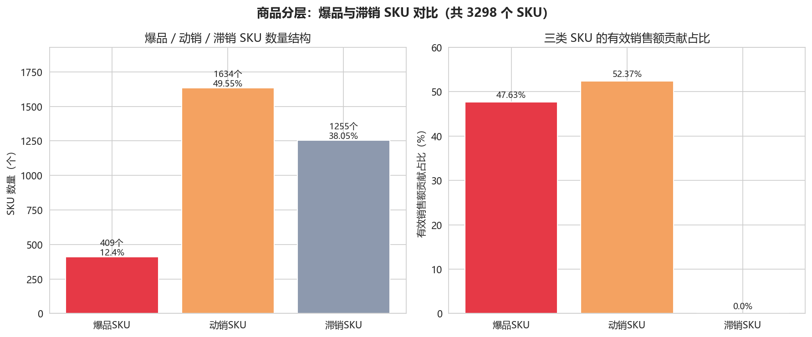

滞销 SKU 进一步拆分为：**358 个全窗口从未被下单**（占全 SKU 10.86%，建议直接进入清仓/下架评估）；另 897 个仅出现在待付款/取消等非完成订单中（「有人看/有人拍但没成交」，应优先诊断价格、详情页、评价与库存承诺）。数据中 `stock_status` 只有「有货」无库存量，本分层以动销速度作为滞销代理指标，库存深度结论受限（见局限性）。

### 2.5 品类转化差异

| 品类 | 浏览用户 | 下单用户 | 浏览→下单转化率 |
|---|---:|---:|---:|
| 运动户外 | 546 | 164 | **30.04%** |
| 食品饮料 | 617 | 174 | 28.20% |
| 母婴用品 | 692 | 182 | 26.30% |
| 美妆个护 | 578 | 151 | 26.12% |
| 图书文具 | 601 | 151 | 25.12% |
| 家居用品 | 541 | 133 | 24.58% |
| 电子产品 | 529 | 120 | 22.68% |
| 服装鞋帽 | 468 | 98 | **20.94%** |

**业务解读**：转化最高（运动户外 30.04%）与最低（服装鞋帽 20.94%）相差 9.1 个百分点。结合 1.6：GMV 第一的食品饮料转化率第二，量效兼备可继续给流量；服装鞋帽「逛的人不少、买的人最少」，优先做尺码/退换/详情页与评价治理；运动户外转化效率最高但 GMV 仅排第 7，存在「扩 SKU + 加流量」的双升空间。

### 2.6 平台 × 会员等级多维对比（注册用户→有效购买转化率）

| 平台 | 注册用户 | 有效购买用户 | 平台购买转化率 | 最弱/最强等级 |
|---|---:|---:|---:|---|
| 淘宝 | 1,468 | 630 | **42.92%** | 各等级均衡（42.11%~43.73%） |
| 京东 | 1,551 | 444 | 28.63% | 钻石 32.52% 最强 |
| 抖音 | 2,467 | 569 | **23.06%** | 金卡 20.89% 最弱 |

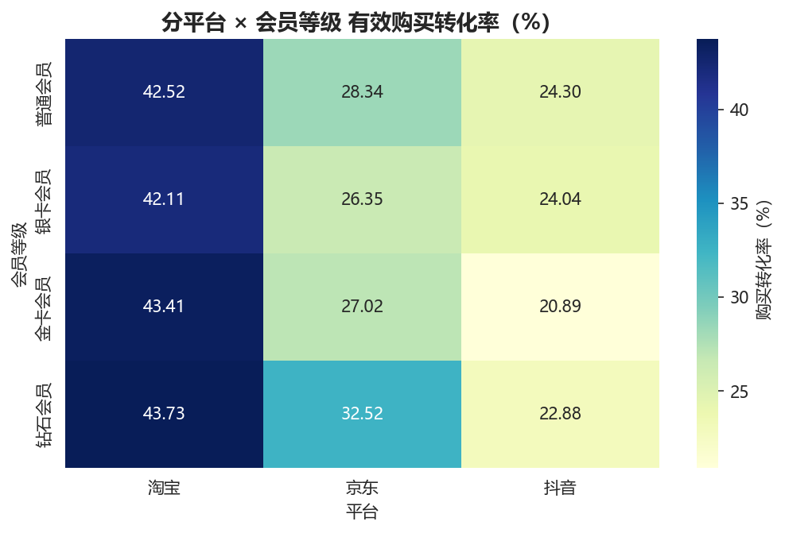

**业务解读（标记薄弱维度）**：抖音用 44.97% 的注册用户只贡献 30.79% 的 GMV、23.06% 的购买转化率，是「拉新强、留存成交弱」的典型；淘宝用户质量最高（每 10 个注册用户 4.3 个完成购买）；京东会员价值随等级递增（钻石 32.52% vs 金卡 27.02%），是三平台中唯一呈现等级梯度的渠道。

### 2.7 月度 GMV 趋势

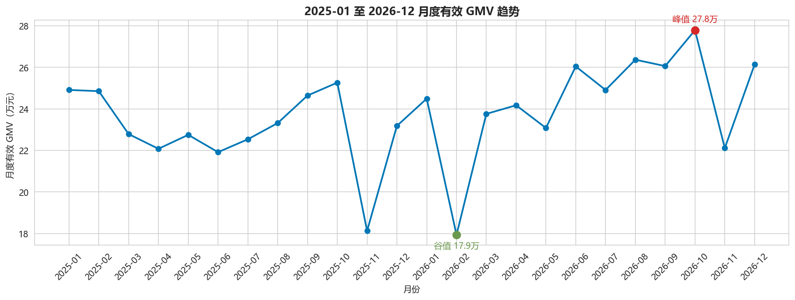

- 24 个月 GMV 在 17.93 万 ~ 27.79 万区间窄幅波动；峰值 **2026-10（277,914.57 元）**，谷值 **2026-02（179,271.64 元）**；2025 全年 276.35 万元、2026 全年 292.86 万元，**同比 +5.97%**。
- 业务解读：增长平缓、无大促尖峰，符合该数据集特征（无真实营销脉冲），经营策略应以结构性提效为主，而非期待节点爆发。

### 2.8 LTV / ARPU：两种分母口径的人均消费（新增增强指标）

用 RFM 的 M 值（有效消费累计金额，口径见指标 12）计算人均消费，**两种分母必须区分引用**：

| 指标 | 分子 | 分母 | 数值 |
|---|---:|---:|---:|
| 有效购买用户人均累计消费（LTV） | 5,692,092.13 元 | **1,643 名有已完成订单用户** | **3,464.45 元/人** |
| 注册用户人均 GMV（ARPU） | 5,692,092.13 元 | **5,486 名注册用户**（含 3,843 名无有效订单用户） | **1,037.57 元/注册用户** |

**按 RFM 分层的人均累计消费**（LTV 分母为该层购买用户；另给出该层 GMV 摊到全量 5,486 注册用户的参考值，明细 `output/metrics/ltv_segment.csv`）：

| 用户分层 | 人数 | 人均 LTV（元/人） | 层 GMV/全量注册用户（元/人） |
|---|---:|---:|---:|
| 高价值用户 | 434 | **6,096.37** | 482.29 |
| 流失预警用户 | 380 | 4,495.03 | 311.36 |
| 潜力用户 | 387 | 1,658.50 | 117.00 |
| 低价值用户 | 442 | 1,575.38 | 126.93 |

**按注册月份的人均 GMV 趋势**（24 个注册批次完整结果落盘 `output/metrics/ltv_reg_month.csv`）：注册口径 ARPU 在 **786.78（2026-02）~ 1,434.59 元（2026-06）** 之间波动，购买用户人均 LTV 在 **2,859.64（2026-07）~ 4,367.05 元（2026-06）** 之间；注册人数与注册口径 ARPU 相关系数仅 -0.23，不存在「拉新越多人均越低」的明确稀释关系。

**业务解读**：3,464.45 与 1,037.57 之间 3.34 倍的差距即「70.05% 注册用户无有效订单」的量化体现——运营提升 ARPU 有两条路径：做大购买转化率（激活无消费人群）与做大已购人群 LTV（提频升单），结合 RFM 结构，当前更高确定性的抓手是后者（高价值 + 流失预警已贡献 76.49% GMV）。

---

### 2.9 复购间隔分布（把「平均订单间隔」从均值升级为分布）

2.2 与 3.4 的「平均订单间隔」是**用户等权均值**，只反映中枢水平；这里补充分布与分位点，落盘 `output/metrics/repurchase_interval_dist.csv`、`repurchase_interval_summary.csv`：

| 用户分层 | 有复购用户数 | 复购间隔对数 | P25 | 中位数 | P75 | P90 | 用户等权均值（对齐 3.4 节） |
|---|---:|---:|---:|---:|---:|---:|---:|
| 高价值用户 | 231 | 423 | 50.5 | 119.0 | 308.5 | 475.6 | **254.0** |
| 流失预警用户 | 93 | 114 | 50.2 | 112.0 | 188.0 | 273.8 | **135.7** |
| 潜力用户 | 33 | 36 | 97.2 | 231.5 | 390.8 | 531.0 | **268.5** |
| 低价值用户 | 0（全部 F=1） | 0 | — | — | — | — | — |

**口径提示（引用时必须注明）**：本表分位点按**订单对等权**（每对相邻订单算一次），而 2.2 / 3.4 节的「平均订单间隔」按**用户等权**（先按用户求均值、再按层求均值）。因此高价值层的订单对中位数 119 天显著低于用户等权均值 254 天——前者被「复购次数多、间隔短」的少数用户拉低。两个口径都对，**混用会自相矛盾**。

**业务解读**：① 高价值层 423 个复购间隔对中有 19.15% 超过 360 天，即便最核心的人群也以「年购」为主；② 流失预警层 93 人、114 对，31.58% 落在 90~180 天，其「平均 504.5 天未购」是长期沉默而非短周期波动；③ 潜力层只有 36 个复购对、中位 231.5 天，提频空间大但基数小。整体印证 2.1 节：复购引擎缺失，且各层普遍长间隔。图见 fig16。

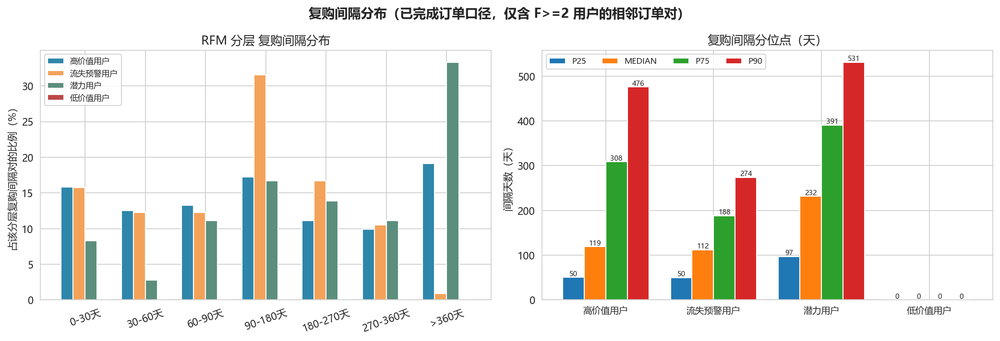

---

## 阶段 3：业务特征挖掘 EDA

### 3.1 年龄段 × 转化与客单

| 年龄段 | 注册用户 | 有效购买用户 | 购买转化率 | 客单价（元） | GMV（万元） |
|---|---:|---:|---:|---:|---:|
| 18-25 岁 | 1,011 | 309 | 30.56% | 2,635.38 | 107.26 |
| 26-35 岁 | 1,258 | 350 | 27.82% | **2,664.61** | 122.84 |
| 36-45 岁 | 1,326 | 389 | 29.34% | 2,505.74 | 128.80 |
| 46-60 岁 | 1,891 | 595 | **31.46%** | 2,521.77 | **210.32（36.95%）** |

观测：各年龄段转化率差异不大（极差 3.64pp），46-60 岁人群因基数最大贡献 36.95% GMV，是规模基本盘；26-35 岁客单价最高，适合做中高客单新品首发。

### 3.2 城市维度

10 城购买转化率落在 **27.67%（上海）~ 32.11%（深圳）** 之间，深圳、成都（31.64%）、西安（31.14%）居前；城市间极差仅 4.44pp，地域不是本业务的主要分化变量，城市精细化运营优先级低于平台与用户分层。

### 3.3 商品价格带与转化

| 标价区间 | 浏览用户 | 浏览→下单转化率 | GMV（万元） | GMV 占比 |
|---|---:|---:|---:|---:|
| 0-200 元 | 157 | 59.24% | 21.77 | 3.82% |
| 200-800 元 | 490 | 62.45% | 79.04 | 13.89% |
| 800-2000 元 | 955 | **63.46%** | 138.29 | 24.30% |
| 2000-4000 元 | 1,599 | 61.16% | **222.85** | **39.15%** |
| 4000-5000 元 | 822 | 59.73% | 107.26 | 18.84% |

观测：转化率在价格带间差异较小（59.2%~63.5%），800-2000 元区间转化效率最高；**2000 元以上中高价位带合计贡献 57.99% GMV**，生意重心在中高客单商品，低价引流款的战略必要性在数据中不成立。

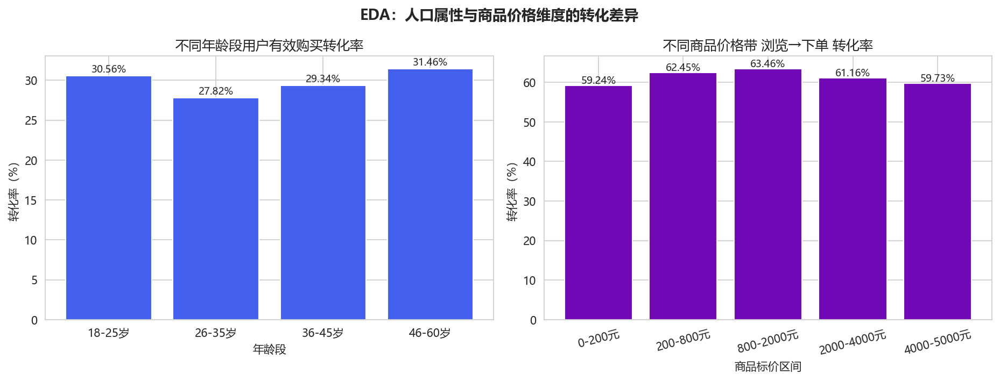

### 3.4 RFM 分层的行为差异

| 分层 | 平均订单间隔（天） | 平均客单价（元） | 行为画像 |
|---|---:|---:|---|
| 高价值用户 | 254.0 | 3,094.60 | 频次近 2 单/窗口、单次消费高，核心资产 |
| 流失预警用户 | **135.7** | **3,457.72** | 有复购习惯且客单最高，但已长期沉默，召回 ROI 预期最高 |
| 潜力用户 | 268.5 | 1,521.56 | 近期活跃但低频低客单，需提频升单 |
| 低价值用户 | 无复购（F=1） | 1,575.38 | 一次性浅度消费 |

> 本表为**用户等权**的平均间隔；按**订单对等权**的间隔分布与分位点见 2.9 节（高价值层订单对中位数 119 天 vs 用户等权均值 254 天，口径差异已在 2.9 节说明，引用时须注明）。

### 3.5 设备类型

`device_type` 全部为 mobile（21,998/21,998，100%），**不存在 PC/移动端对比的数据条件**，本项目不对设备影响下任何结论，避免用单值维度制造伪差异。

### 3.6 轻量逻辑回归（特征方向验证）

以「有浏览行为的 2,711 名用户」为样本（正样本：有下单行为，正样本率 47.25%），使用 sklearn `LogisticRegression` 默认超参 + 特征标准化，样本内评估：训练集 **AUC = 0.78**、准确率 71.49%。本节目的不是训练预测模型，而是验证「下单与哪些特征同向变化」。为此另做 5 组基线对照（见本节末表）：**该模型 99% 的判别力来自「收藏 + 加购」两个中段意图特征**（两特征 AUC 0.7702，全集 0.7766；仅人口属性 0.5124、仅平台 0.5429、去掉意图 0.6492）。系数如下：

| 特征（标准化后） | 系数 | 发生比 exp(β) | 方向解读 |
|---|---:|---:|---|
| 收藏次数 | 1.364 | **3.91** | 最强正向信号，收藏是比加购更深的购买意图表达 |
| 加购次数 | 0.835 | **2.31** | 加购每增加 1 个标准差，下单发生比约升 131%，强正向信号 |
| 是否京东用户 | 0.062 | 1.06 | 微弱正向，与漏斗中京东高转化互证 |
| 是否抖音用户 | -0.052 | 0.95 | 微弱负向 |
| 平均停留时长 | -0.049 | 0.95 | 几乎无关（停留时长为随机生成，不具业务解释力） |
| 年龄 / 会员等级 / 性别 / 浏览次数 | -0.062 ~ -0.009 | ≈1 | 几乎无区分度 |

**基线对照与意图信号先验强度**（落盘 `output/metrics/lr_baseline.csv`、`output/metrics/lr_intent_prior.csv`）：

| 模型 | 特征数 | 训练集 AUC |
|---|---:|---:|
| 随机基线（常数预测器，理论值） | 0 | 0.5000 |
| 仅人口属性（年龄 + 性别 + 会员等级） | 3 | 0.5124 |
| 仅平台（是否京东 / 是否抖音） | 2 | 0.5429 |
| 仅意图（收藏 + 加购） | 2 | **0.7702** |
| 全集（9 特征） | 9 | **0.7766** |
| 全集去意图（7 特征） | 7 | 0.6492 |

| 意图信号 | 用户数 | 有下单行为用户数 | 下单率 |
|---|---:|---:|---:|
| 有加购 | 1,740 | 1,005 | **57.76%** |
| 无加购 | 971 | 276 | 28.42% |
| 有收藏 | 1,496 | 1,010 | **67.51%** |
| 无收藏 | 1,215 | 271 | 22.30% |

> AUC、准确率均为训练集（全样本）样本内评估值，仅说明模型具备基本区分度，**不代表泛化性能**；未做网格搜索、未做交叉验证、无任何调参。

结论：在控制人口属性（AUC 0.5124）与平台（0.5429）之后，**中段意图信号（收藏、加购）是唯一有效变量**——去掉它们，AUC 从 0.7766 掉到 0.6492。这与「抖音卡在加购→下单」的漏斗结论、3.1~3.3 的 EDA 分层结果形成交叉印证：运营抓手应放在中段意图的承接，而不是给人群贴静态标签。**使用边界与自我限定**：① 标签是「行为日志中是否出现下单事件」，而收藏、加购本就是下单的前置动作（有加购者下单率 57.76% vs 无加购 28.42%），因此「意图与下单同向」接近先验常识，**不是新发现**，其价值在于把方向量化并与漏斗结论互证；② 模型无交叉验证、相对最简基线也无实质提升（全集 0.7766 vs 两特征 0.7702），**不足以作为预测模型使用**，仅作方向交叉印证。

---

### 3.7 时段与星期（详见附录 F）

把 `order_time` 的**小时**与**星期**维度补上（此前完全未分析）。结论是**没有可用信号**：全网有效订单在各小时的占比落在 3.47%~5.19%（77~115 单/小时），行为事件数同样平坦（842~993 条/小时）；工作日/周末订单占比为 72.65%/27.35%，而分析窗口（2025-01-01 ~ 2026-12-28，727 天）的自然日占比为 71.39%/28.61%，即日均下单 3.10 单（工作日）与 2.91 单（周末）**基本无差异**。因此**不存在「周末效应」或「大促时段尖峰」**，这也与「无真实营销脉冲」的判断一致；真实业务中该维度通常是最容易拿到增量动作的抓手，本项目据实报告「无信号」而非制造一个高峰时段。落盘 `output/metrics/time_pattern_order.csv`、`time_pattern_behavior.csv`、`time_pattern_weekday.csv`，图见 fig15。

### 3.8 维度同质性检查（详见附录 G）

对照附录 C 的检验口径，对**品牌、支付方式、配送方式、性别、停留时长分箱**补齐了同一套卡方 + Cramer's V 筛查（24 项检验，落盘 `output/metrics/dim_homogeneity_check.csv`）：**18 项 Cramer's V < 0.05，判为无可用信息**。仅有的两处弱关联是 brand×平台（V=0.057）与 brand×一级品类（V=0.0723），效应量过小、不足以支撑品牌维度的运营结论；`gender×平台` 的 p=0.0065 显著但 V 仅 0.0303，正好说明**大样本下 p 值显著不等于业务意义**。这一节的目的就是把「没做品牌/支付方式分析」变成「做了筛查并证明这些维度没有可用信息」。

---

## 阶段 4：BI 可视化与看板方案

### 4.1 图表清单（14 张分析图存于 `figures/`，编号 fig01~fig08、fig12~fig17；Power BI 看板截图存于 `bi_screenshots/`）

| 文件 | 图名 |
|---|---|
| fig01_分平台转化漏斗对比.png | 分平台漏斗用户数 + 环节转化率双面板 |
| fig02_Cohort同期群留存热力图.png | 24 批次 × 30/60/90 天留存矩阵 |
| fig03_RFM用户分层占比饼图.png | RFM 四类人数占比（含 GMV 贡献图例） |
| fig04_各品类销售额柱状图.png | 8 大品类 GMV 与订单量 |
| fig05_爆品与滞销SKU对比.png | 三类 SKU 数量结构与 GMV 贡献 |
| fig06_月度GMV趋势折线图.png | 24 个月 GMV 趋势（标注峰谷） |
| fig07_平台会员等级转化率.png | 平台 × 等级购买转化率热力图（补充） |
| fig08_EDA年龄与价格带转化.png | 年龄段/价格带转化双面板（补充） |
| fig12_订单状态分布与平台构成.png | 扩展专题一：全量订单状态分布 + 各平台状态 100% 堆叠（附录 C） |
| fig13_促销完成率与成交标价比率.png | 扩展专题二：促销类型完成率/折扣深度双轴 + 成交/标价比率分布（附录 D） |
| fig14_品类共购lift与UPT.png | 扩展专题三：8×8 品类共购 lift 热力图 + 已完成订单 UPT/件单价（附录 E） |
| fig15_下单时段与星期结构.png | 扩展专题四：分时段订单分布 + 分平台时段结构 + 工作日/周末（附录 F） |
| fig16_复购间隔分布.png | 阶段 2.9：RFM 分层复购间隔分布 + 间隔分位点 |
| fig17_帕累托累计贡献曲线.png | 阶段 2.3：用户/SKU 累计贡献曲线（CUME_DIST 口径） |

**Power BI 看板实物（`bi_screenshots/`，在 Power BI Desktop 中手工搭建并导出，不随流水线生成）**：

| 文件 | 内容 |
|---|---|
| bi_01_经营总览.png | 页面 1：KPI 卡片（GMV / 有效订单 / 客单价 / 有效购买用户 / 高价值+流失预警 GMV 占比）+ 月度 GMV 趋势 + 分平台 GMV 占比 |
| bi_02_转化漏斗.png | 页面 2：整体漏斗 + 分平台环节转化率 + 品类浏览→下单转化率 |
| bi_03_用户商品运营.png | 页面 3：RFM 分层 + Cohort 留存矩阵 + 品类销售 + SKU 分层 |
| 多平台电商经营看板.pbix | 看板源文件（Power BI Desktop 打开可查看数据模型与全部视觉对象） |

### 4.2 PowerBI 聚合结果集（`output/bi/`，UTF-8 BOM 可直接导入）

| 文件 | 粒度 | 用途 |
|---|---|---|
| fct_platform_metrics.csv | 平台 | 经营总览 KPI |
| fct_monthly_gmv.csv | 月份 | 月度趋势折线 |
| fct_funnel.csv | 平台 × 漏斗环节 | 漏斗图（含全网行） |
| fct_rfm_summary.csv / dim_user_rfm.csv | 分层 / 用户 | RFM 结构与用户明细 |
| fct_category_sales.csv / fct_category_funnel.csv | 品类 | 品类销售与转化 |
| dim_sku_label.csv / fct_sku_label_summary.csv | SKU / 分层 | 滞销清单与结构 |
| fct_cohort_retention.csv | 注册批次 | Cohort 矩阵 |
| fct_platform_level.csv | 平台 × 等级 | 多维下钻 |
| fct_level_metrics.csv | 会员等级 | 等级贡献 |
| fct_order_status.csv | 平台 × 订单状态（含全网行） | 扩展专题一：状态结构监控（附录 C） |
| fct_promo_summary.csv | 平台 × 促销类型 | 扩展专题二：促销/券/折扣观察（附录 D） |
| fct_category_pair.csv | 品类对（28 对） | 扩展专题三：共购 lift 矩阵（附录 E） |

模型关系建议：`fct_*` 为事实表，`dim_sku_label / dim_user_rfm` 为维度表，以 SKU/用户 ID 关联；平台、月份、品类为共享筛选维度。

### 4.3 Power BI 三页看板

- **页面 1｜经营总览**：KPI 卡片（GMV 569.21 万、有效订单 2,216、客单价 2,568.63、有效购买用户 1,643、RFM 高价值+流失预警 GMV 占比 76.49%）；月度 GMV/订单量双轴折线；平台 GMV 占比环形图；切片器：年/月、平台。
- **页面 2｜转化漏斗分析**：整体漏斗（2,711→2,368→1,953→1,734）；三平台环节转化率对比折线；各环节流失人数条形图；品类浏览→下单转化率条形图。
- **页面 3｜用户 & 商品运营**：RFM 四象限/饼图 + 各类 GMV 贡献；Cohort 热力图；品类 GMV 柱图；滞销 SKU 明细表（1,255 个，可按「从未下单 358 个」筛选）；爆品 SKU TOP 榜。

三页看板已在 **Power BI Desktop** 中按 `report/PowerBI搭建指南.md` 实际搭建完成（数据源为 `output/bi/` 下 15 张聚合表，含数据模型关系、切片器与自定义度量值），源文件与页面截图存于 `bi_screenshots/`：

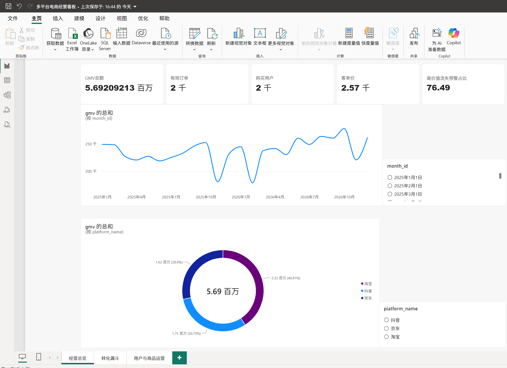

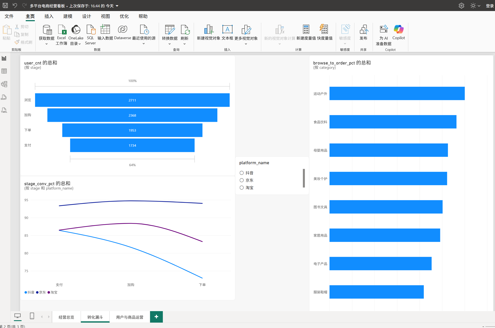

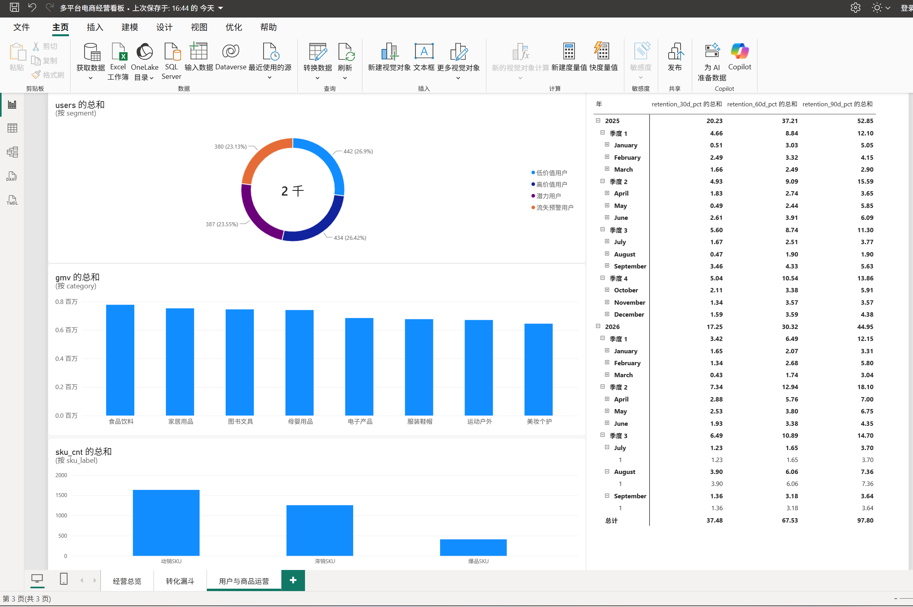

### 4.4 扩展专题图表（附录 C~G）

应需求追加的存量数据专题（未完成订单下钻、促销与折扣、购物篮连带、时段与星期、维度同质性、复购间隔、帕累托累计曲线）图表，与前面的分析图保持同一套字体与配色：

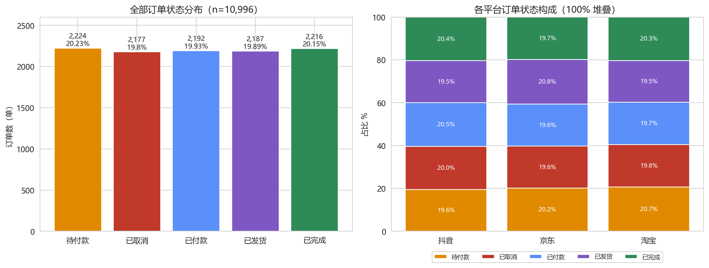

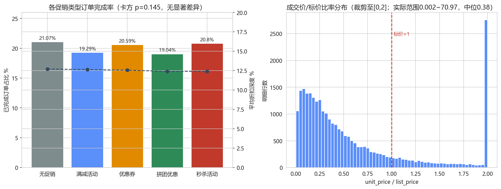

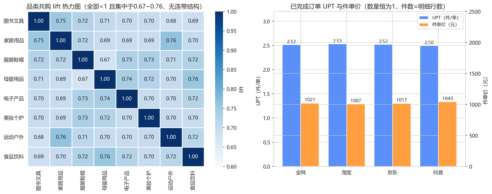

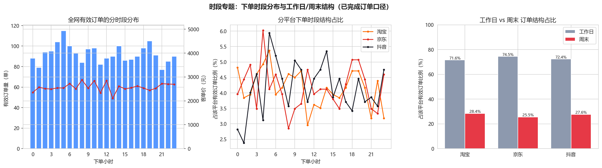

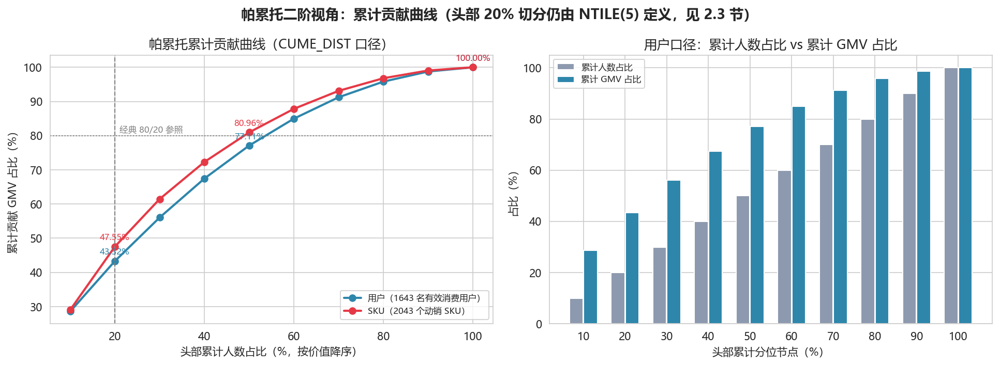

---

## 阶段 5：核心业务洞察、落地建议与局限性

### 5.1 核心量化洞察（数据事实）

1. **最大流失卡点在抖音的「加购→下单」**：该环节转化率 72.98%，较京东低 21.05pp，单环节流失 248 人占三平台该环节流失总量的 59.8%；抖音占 41.46% 的浏览量却只完成 30.79% 的 GMV。
2. **京东转化效率最高（浏览→支付 83.15%）但流量最小**（浏览仅占 27.4%）；淘宝体量最大、转化居中（63.67%），支付环节仍有 6.84pp 追赶空间。
3. **近半数高价值用户正在流失**：高价值（46.48% GMV）+ 流失预警（30.01% GMV）合计 76.49% GMV；流失预警人群平均已 504.5 天未购、历史客单 3,458 元为四类最高。
4. **会员等级体系失效**：钻石与金卡 GMV 占比仅差 4.81pp、客单差 3.1%，等级未带来消费分化。
5. **商品两极并存**：12.40% 的爆品 SKU 贡献 47.63% GMV；38.05% 的 SKU（1,255 个）零有效成交，其中 358 个从未被下单。
6. **集中度健康但有聚焦空间**：头部 20% 用户贡献 43.40% GMV、头部 20% SKU 贡献 47.63%，均低于 80/20。
7. **复购极弱**：90 天留存平均仅 4.66%，月度 GMV 两年同比仅 +5.97%，无增长引擎。
8. 转化的相关信号来自**行为意图（收藏 OR=3.91、加购 OR=2.31；逻辑回归训练集 AUC=0.78，基线对照见 3.6 节）而非人口属性**；46-60 岁贡献 36.95% GMV，2000 元以上价格带贡献 57.99% GMV，城市间无显著差异。
9. **时间与多数维度没有可用信号**：各小时下单占比 3.47%~5.19%、工作日/周末 72.65%/27.35% 与自然日 71.39%/28.61% 基本一致；品牌、支付方式、配送方式、性别、停留时长共 24 项卡方检验中 18 项 Cramer's V<0.05（附录 F、G）。这些是「数据里没有信号」的结论，不产出运营动作。

### 5.2 可落地运营建议

**A. 分平台运营策略**
- **抖音（提转化，优先级最高）**：针对加购未下单人群上线「购物车限时券 + 库存紧张提示 + 直播间专属价」三件套；以京东 94.03% 为理论参照，若该环节提升 10pp（918 人×10%≈92 单），按抖音客单 2,604 元静态测算可带来约 **24 万元/窗口的增量 GMV 潜力**（不计稀释，需小流量验证）；同时做短视频/直播挂链商品与爆品清单（409 个）的强绑定。
- **京东（扩流量）**：维持高转化承接能力，把预算从转化补贴转到站外拉新与品类扩充；向高转化的运动户外品类增加供给。
- **淘宝（守基本盘 + 补支付）**：对未支付订单优化收银台优惠提醒与支付方式引导（向京东 93.34% 看齐，6.84pp 缺口约对应 43 单/窗口）；利用 42.92% 的高注册转化做会员承接试点。

**B. 用户分层维护策略**
- **高价值用户（434 人）**：专属客服、新品优先购、退换免举证、年度感恩礼；目标维持其 46.48% GMV 基本盘。
- **流失预警用户（380 人，优先级最高的召回池）**：按历史 M 排序分批触达，高 M 人群用短信/Push + 无门槛召回券（参考其 3,458 元历史客单，单客召回盈亏空间大）；以「历史浏览品类新品到岗」为话术，召回效果通过召回券核销率回收验证。
- **潜力用户（387 人）**：以提频为目标——第二单复购券、凑单满减、同品类关联推荐，推动 F 从 1.09 向 2 跨越。
- **低价值用户（442 人）**：仅做低成本内容/消息触达，不投放补贴；3,843 名无有效消费注册用户走新人首单券自动化流程即可。

**C. 商品与库存策略**
- **爆品 409 个**：建立安全库存与备货预警（当前库存字段只有「有货」，真实业务须补库存量字段），在三平台详情页做交叉推荐，把爆品流量导向同品类动销 SKU。
- **滞销 1,255 个**：358 个从未下单 SKU 进入清仓/下架/捆绑销售流程；897 个「拍下未成交」SKU 逐项排查价格竞争力、详情页、评价数量与运费。
- **品类治理**：服装鞋帽（转化 20.94% 最低）做尺码助手、买家秀、退换政策优化；运动户外（30.04% 最高）扩 SKU、加首页资源位；食品饮料量效兼备，维持供给稳定。

### 5.3 项目局限性

1. 数据集为**公开数据集**，非线上生产业务数据，不存在真实大促脉冲与自然流量波动（月度 GMV 稳定在 18~28 万），所有结论用于方法演示与内部参考，不代表真实平台经营水平。
2. **促销/折扣字段在本数据集中不含可分析的业务信号**（详见附录 D）：promotion_id 仅 5 类粗粒度标记、无活动预算/触达/曝光数据；且各促销标记订单占比、完成率、折扣深度几乎一致（用券/无券完成率 20.14% vs 20.16%，卡方 p=0.997），成交/标价比率无勾稽（0.002~70.97），无法量化营销活动的真实转化增益与 ROI，真实业务需补曝光、核销、补贴成本字段后重做。
3. 地理位置粒度仅到 **city 城市**（10 城），无法做区县级地域分析；经纬度字段全部为 0。
4. **没有用户消息触达、召回的业务记录**，本报告的召回策略仅为数据分析推论，无法用历史数据验证实际召回效果，上线后须以 A/B 或准实验回填效果（本项目本身不做 A/B 实验）。
5. **RFM 分层基于该数据集**，NTILE 等频阈值与四类规则需结合真实业务的复购周期、毛利结构重新校准；数据中 50.01% 订单早于注册日期，Cohort 留存口径下注册前订单不计入，留存绝对值可能被低估。
6. 库存字段只有「有货」状态、无库存量，无法识别真正的高库存积压，滞销结论以动销速度代理；device_type 全为 mobile、子品类全为「其他」、tags/app_version 全空，设备对比、子品类下钻、标签分析均不具备数据条件。
7. **交易后段字段与商品组合呈独立生成标记**（详见附录 C/E）：5 种订单状态各约 20%、与平台/金额带/促销/用券均无统计关联（卡方 p≥0.145），待付款与已取消订单画不出结构性差异，`payment_time` 在待付款/取消订单中也全部有值，支付时效不能用于真实流失预警；每单固定抽 2~3 个跨品类商品，28 个品类对 lift 全部挤在 0.67~0.76，交叉销售结构不可识别。

### 5.4 三重指标交叉校验结论

- SQL 腿：`code/data_process.sql` 的 22 个 SECTION（1 个建视图的 setup + 5 个数据质量复核 + 16 个指标结果分段）；Python 腿：pandas 不读 SQL 结果独立重算 9 项核心指标（`output/metrics/cross_check_sql_python.csv`）——9/9 全部一致；Excel 腿：按旧版兼容写法（SUMIFS / COUNTIFS / VLOOKUP / SUMPRODUCT + 辅助列）在同一工作簿内重建同一批指标，计算值缓存在根目录 `cross_check.xlsx`（公式与逐步操作说明见 `excel_cross_check.md`）。三方口径一致后，本报告全部数字方可引用。

---

## 附录 A：Cohort 留存口径敏感性对照（注册前订单是否计入）

针对异常 #1（50.01% 订单时间早于注册日期），在主口径「注册前订单不计入（offset 1~N 天）」之外，重算一版**宽松口径：注册前/注册当日订单全部计入（offset ≤ N 天）**；两版均只对 90 天窗口完整的 **21 个批次**取均值，逐批次结果落盘 `output/metrics/cohort_sensitivity.csv`。

| 留存窗口 | 主口径均值（严格） | 宽松口径均值（注册前计入） | 差异 | 主口径批次区间 | 宽松口径批次区间 |
|---|---:|---:|---:|---|---|
| 30 天 | **1.78%** | **15.29%** | +13.51pp | 0.43% ~ 3.90% | 0.51% ~ 27.57% |
| 60 天 | **3.22%** | **16.49%** | +13.27pp | 1.65% ~ 6.06% | 3.03% ~ 28.50% |
| 90 天 | **4.66%** | **17.70%** | +13.04pp | 1.90% ~ 7.36% | 5.05% ~ 29.47% |

**口径差异与结论影响**：① 两版差距约 13~14pp，说明主口径绝对值确实受时序异常压制、存在低估，报告正文对留存统一标 [中置信度]；② 即便按最宽松口径，30/60/90 天留存也仅 15.29%/16.49%/17.70%，仍属极低水平，**「业务缺少复购引擎」的定性结论在两种口径下均成立**；③ 主报告仍采用严格口径——注册前的订单在业务逻辑上不构成「注册后留存」，宽松版仅作为低估幅度的量化对照，不替代主结论。

## 附录 B：漏斗口径敏感性对照（环节去重用户 vs 严格路径）

主口径（1.4 节）按环节独立去重用户；此处增加**严格路径口径**：同一用户在同一平台内，加购须先有浏览记录、下单须同时有浏览+加购、支付须前三环节齐全。分母变化：浏览仍是起点（全网 2,711 人不变）；全网加购由 2,368 人收缩为 **1,740 人——628 名「有加购无浏览」用户从漏斗消失**；下单收缩为 1,005 人、支付 674 人（另有 948 人有下单但无完整「浏览+加购」路径）。逐平台结果落盘 `output/metrics/funnel_strict_path.csv`。

| 平台 | 主口径：加购→下单 | 主口径：浏览→支付 | 严格：浏览→加购 | 严格：加购→下单 | 严格：下单→支付 | 严格：浏览→支付 |
|---|---:|---:|---:|---:|---:|---:|
| 淘宝 | 83.27% | 63.67% | 67.22% | 62.68% | 67.42% | **28.40%** |
| 京东 | 94.03% | **83.15%** | 61.19% | 57.71% | 67.18% | 23.72% |
| 抖音 | **72.98%（最低）** | 51.51% | 63.88% | **53.90%（最低）** | 66.67% | 22.95% |
| 全网 | 82.47% | 63.96% | 64.18% | 57.76% | 67.06% | 24.86% |

**口径差异与结论影响**：① 严格口径下各环节绝对值大幅下降，主因是行为日志独立采样（99.99% 会话仅 1 条行为），并不代表真实路径流失，故主报告不采用该口径做 KPI；② 平台效率排名发生变化：全链路口径下淘宝（28.40%）升至第一、京东（23.72%）与抖音（22.95%）接近，「京东效率最高」仅在环节去重口径下成立；③ **但抖音「加购→下单」在两种口径下均为三平台最低（72.98% / 53.90%），核心干预靶点结论稳健不变**。

## 附录 C：扩展专题一 · 未完成订单下钻（全量订单口径）

> 口径：全部 **10,996** 个订单（区别于 GMV 仅取"已完成"的口径）；金额取 `total_amount`。落盘表：`order_status_overview.csv`、`order_status_platform.csv`、`order_status_amount_band.csv`、`order_status_category.csv`、BI `fct_order_status.csv`；图：`fig12`。

**C.1 状态总览（金额单位：万元）**

| 状态 | 分组 | 订单数 | 订单占比 | 涉及用户数 | 意向金额 | 金额占比 | 平均客单 | 平均支付时效(分) |
|---|---|---:|---:|---:|---:|---:|---:|---:|
| 待付款 | 流失类 | 2,224 | 20.23% | 1,634 | 566.9 | 20.28% | 2,549.19 | 32.41 |
| 已取消 | 流失类 | 2,177 | 19.80% | 1,648 | 547.2 | 19.57% | 2,513.62 | 32.14 |
| 已付款 | 在途类 | 2,192 | 19.93% | 1,607 | 563.0 | 20.14% | 2,568.56 | 32.62 |
| 已发货 | 在途类 | 2,187 | 19.89% | 1,631 | 549.7 | 19.66% | 2,513.42 | 31.84 |
| 已完成 | 已完成 | 2,216 | 20.15% | 1,643 | 569.2 | 20.36% | 2,568.63 | 33.06 |

- 按字段字面：全量订单意向金额 2,796.0 万元；**流失类（待付款+已取消）4,401 单、占 40.02%、金额 1,114.1 万元**；在途类（已付款+已发货）4,379 单、占 39.82%、金额 1,112.7 万元。
- **但该状态分布不能作为真实流失率解读**：真实业务中 5 种状态应随订单生命周期递进，而本数据各状态订单量近似均匀（各约 20%）、月份占比也稳定在 17%~24%，呈现独立随机标记特征。

**C.2 独立性检验（观察性，非 A/B 实验）**

| 检验对 | 方法 | 统计量 | p 值 | Cramer's V | 结论 |
|---|---|---:|---:|---:|---|
| 订单状态 × 平台 | 卡方 | 4.52 | 0.807 | 0.014 | 独立 |
| 订单状态 × 促销类型 | 卡方 | 21.95 | 0.145 | 0.022 | 独立 |
| 订单状态 × 金额带 | 卡方 | 17.53 | 0.352 | 0.020 | 独立 |
| 订单状态 × 是否用券 | 卡方 | 0.16 | 0.997 | 0.004 | 独立 |

**C.3 数据特性与业务含义**：① 4 项检验 p 值全部 >0.05 且效应量 V<0.03——未完成订单在平台、金额、促销、用券维度上**画不出任何结构性画像**，无法回答"什么样的订单更容易流失"；② `payment_time` 在待付款/已取消订单中也 100% 有值，下单→支付时长在 5 种状态下均为 5~60 分钟（中位 32~34 分），该字段不具备流失预警含义；③ 金额勾稽：`total_amount = Σ order_item.item_total`（27,523 行最大误差 < 1e-12 元），但 `discount_amount/shipping_fee/tax_amount` 不参与勾稽，为独立生成字段（见附录 D）。

## 附录 D：扩展专题二 · 促销 / 优惠券 / 折扣专题

> 落盘表：`promo_type_summary.csv`、`coupon_summary.csv`、`discount_realized_price.csv`、`topic_stat_tests.csv`（含附录 C 的 4 项检验）、BI `fct_promo_summary.csv`；图：`fig13`。
> 字段实况：`promotion_id` 100% 填充（5 类，含"无促销"2,212 单）；`coupon_code` 5,476 单非空（49.8%）；`discount_amount` 全部 >0（最小 0.01 元，"无促销"订单同样有折扣）。自定义折扣深度 = discount/(total+discount)，因两者不勾稽，仅作组间相对比较。

**D.1 促销类型与完成率（全部订单）**

| 促销类型 | 订单数 | 占比 | 平均应付(元) | 平均折扣深度 | 完成单数 | 完成率 | 完成单 GMV(元) |
|---|---:|---:|---:|---:|---:|---:|---:|
| 无促销 | 2,212 | 20.12% | 2,540.34 | 12.71% | 466 | **21.07%** | 1,186,801.84 |
| 满减活动 | 2,203 | 20.03% | 2,511.96 | 12.64% | 425 | 19.29% | 1,074,451.54 |
| 优惠券 | 2,147 | 19.53% | 2,530.56 | 12.56% | 442 | 20.59% | 1,127,160.23 |
| 拼团优惠 | 2,232 | 20.30% | 2,581.11 | 12.41% | 425 | **19.04%** | 1,101,473.18 |
| 秒杀活动 | 2,202 | 20.03% | 2,549.28 | 12.41% | 458 | 20.80% | 1,202,205.34 |

- 用券 vs 无券完成率：**20.14% vs 20.16%**（卡方 p=0.997）；分平台差异同样在 ±0.6pp 内（淘宝 20.12/20.41、京东 19.95/19.55、抖音 20.35/20.42）。
- 5 类促销的折扣深度全部挤在 12.41%~12.71%，连"无促销"订单平均也有 12.71% 的折扣额。
- Spearman：折扣深度 × 是否完成 rho=0.006（p=0.55，无关）；折扣深度 × 订单金额 rho=−0.022（p=0.019 但效应量可忽略，深度每变化几乎不带来金额变化）。

**D.2 成交价 / 标价比率（order_item.unit_price ÷ product.price，27,523 行）**

| 范围 | 全网 | 备注 |
|---|---|---|
| 5% 分位 | 0.043 | 极端低价行存在（最低 0.002） |
| 中位数 | **0.378** | 各品类中位 0.345（图书文具）~0.410（食品饮料），无品类差异 |
| 95% 分位 | 3.647 | 极端高价行存在（最高 70.97 倍标价） |
| 低于标价占比 | 79.70% | 高于标价 20.26%，恰好等于标价仅 10 行 |

**D.3 结论与边界**：促销标签、优惠券、订单折扣额、明细成交价四个字段与订单完成状态、订单金额、品类之间**均无业务上可解释的关联**，与附录 C 的"字段独立生成标记"判断一致。因此本报告不产出"哪种促销更有效""券拉动了多少 GMV"类结论（数据不支持，任何此类数字都将是伪相关）；真实业务中评估促销效果需要曝光、触达、核销、补贴成本字段与对照组设计（A/B 或准实验），本项目不具备该条件。

## 附录 E：扩展专题三 · 购物篮连带分析

> 落盘表：`basket_metrics.csv`、`category_pair_lift.csv`（28 对）、BI `fct_category_pair.csv`；图：`fig14`。
> 结构事实：27,523 个明细行 `quantity` 恒为 1；每单恰好 2 行（5,465 单，49.70%）或 3 行（5,531 单，50.30%）→ **件数 = 明细行数**。因此传统"多件订单占比"口径恒为 100% 无区分度，本专题改用 UPT、件单价与跨品类订单占比。

**E.1 篮子指标（双口径）**

| 范围 | 口径 | 订单数 | 件数 | UPT（件/单） | 件单价(元) | 跨品类订单占比 |
|---|---|---:|---:|---:|---:|---:|
| 全网 | 全量订单 | 10,996 | 27,523 | 2.503 | 1,015.91 | 93.37% |
| 全网 | 已完成订单 | 2,216 | 5,576 | **2.516** | **1,020.82** | 93.77% |
| 淘宝 | 已完成订单 | 912 | 2,306 | 2.529 | 1,007.37 | 93.64% |
| 京东 | 已完成订单 | 631 | 1,590 | 2.520 | 1,016.62 | 93.98% |
| 抖音 | 已完成订单 | 673 | 1,680 | 2.496 | 1,043.26 | 93.76% |

勾稽验证：已完成口径 UPT × 件单价 = 2.516 × 1,020.82 ≈ **2,568.6 元 = 客单价**（1.3 节），指标自洽。仅含 1 个品类的订单 729 个（6.63%）。

**E.2 品类共购关联规则（8 品类 28 对，全量订单）**

| 品类对 | 共购单数 | support | confidence(A→B) | lift |
|---|---:|---:|---:|---:|
| 家居用品 × 运动户外 | 641 | 5.83% | 20.87% | **0.763（最高）** |
| 母婴用品 × 食品饮料 | 739 | 6.72% | 23.48% | 0.756 |
| 图书文具 × 家居用品 | 660 | 6.00% | 21.01% | 0.752 |
| 服装鞋帽 × 母婴用品 | 589 | 5.36% | 19.28% | **0.674（最低）** |

- 28 对 lift 全部落在 **0.674~0.763**（均值 0.712、标准差仅 0.023），support 集中在 5.3%~6.7%，没有任何一对显著跳出。
- lift 机械性 <1 的原因：每单从 8 个品类中只抽 2~3 个（且不放回），给定一单含 A，剩余槽位变少，P(B|A) 天然小于 P(B)。判断连带结构应看相对离散度——0.09 的全距与 0.023 的标准差表明**品类配对与均匀随机抽取无法区分**，不存在可识别的交叉销售结构，故不产出"捆绑销售/搭配推荐"清单。
- UPT 与件单价的平台差异在 0.03 件、36 元以内，无业务意义。

---

## 附录 F：扩展专题四 · 时段与星期结构（已完成订单 + 全量行为口径）

> 落盘表：`time_pattern_order.csv`（全网 + 分平台 × 24 小时）、`time_pattern_behavior.csv`（四环节行为事件 × 24 小时）、`time_pattern_weekday.csv`（工作日/周末，含自然日基准）；图：fig15。
> 口径：订单类取「已完成」有效订单（2,216 单），行为类取 `user_behavior` 全量事件（21,998 条）；自然日基准按分析窗口 2025-01-01 ~ 2026-12-28 共 727 天计算。

**F.1 分时段汇总（全网，四时段分组）**

| 时段 | 有效订单量 | GMV（万元） | 订单占比 | 客单价（元） |
|---|---:|---:|---:|---:|
| 00:00-05:59 | 575 | 143.93 | 25.95% | 2503.13 |
| 06:00-11:59 | 554 | 146.26 | 25.00% | 2640.14 |
| 12:00-17:59 | 541 | 137.37 | 24.41% | 2539.22 |
| 18:00-23:59 | 546 | 141.64 | 24.64% | 2594.20 |

- 逐小时订单占比区间为 3.47%~5.19%（最低 21 时 77 单，最高 5 时 115 单），**不存在可识别的下单高峰**；行为事件数同样在 842~993 条/小时之间平坦分布。
- 分平台看时段结构也无差异（淘宝/京东/抖音的逐小时占比曲线高度重合，见 fig15 中图）。

**F.2 工作日 vs 周末**

| 日期类型 | 有效订单量 | GMV（万元） | 订单占比 | 自然日占比 | 日均订单（单/天） |
|---|---:|---:|---:|---:|---:|
| 工作日 | 1610 | 414.27 | 72.65% | 71.39% | 3.10 |
| 周末 | 606 | 154.94 | 27.35% | 28.61% | 2.91 |

**F.3 结论与边界**：工作日订单占比 72.65% 与自然日占比 71.39% 相差不到 1.3pp，折成日均下单量 3.10 单（工作日）与 2.91 单（周末）**基本无差异**，即**不存在周末效应**；结合月度 GMV 同比 +5.97%、无大促脉冲（2.7 节），本数据没有真实流量节奏，时段与星期维度**不产出任何运营结论**。这与「公开数据集」的定位一致；真实业务中该维度通常是排班、投放时段与活动启动时间的关键抓手，落地前必须用真实数据重跑一遍。

## 附录 G：扩展专题五 · 维度同质性检查（品牌 / 支付方式 / 配送方式 / 性别 / 停留时长）

> 落盘表：`dim_homogeneity_check.csv`（24 项检验）；方法与附录 C 完全一致：卡方检验 + Cramer's V 效应量，`V<0.05` 判为无可用信息、`0.05<=V<0.1` 为弱关联、`V>=0.1` 为有信息。
> 目的：把「没做品牌 / 支付方式 / 配送方式 / 性别分析」变成「做了筛查并证明这些维度没有可用信息」。粒度已在表内 `grain` 列注明（订单级 / 订单明细行 / 行为事件）。

**G.1 检查结果概览**

| 维度 | 取值数 | 检验项 | 结果 |
|---|---:|---:|---|
| 支付方式 payment_method | 5 | 4（× 状态/金额带/平台/是否完成） | 全部 V<=0.0213，无可用信息 |
| 配送方式 shipping_method | 3 | 4 | 全部 V<=0.0194，无可用信息 |
| 性别 gender | 2 | 4 | 全部 V<=0.0303，无可用信息 |
| 停留时长 duration_band | 4 | 2（× 行为环节/平台） | V=0.0149 / 0.0114，无可用信息 |
| 品牌 brand | 10 | 5 | 3 项 V<0.02 无信息；× 平台 V=0.057、× 一级品类 V=0.0723 为**弱关联** |
| 商品分层 sku_label | 3 | 5 | V=0.0245~0.179，但**口径内生**（见 G.3） |

- 24 项检验中 **18 项 Cramer's V < 0.05**（判为无可用信息），占比 75%。
- 一个值得记住的统计细节：`gender × 平台` 的卡方 p=0.0065 显著，但 Cramer's V 仅 0.0303 —— **大样本下 p 值显著不等于业务上有意义**，这也是本项目一律「p 值 + 效应量」并列报告的原因。

**G.2 业务含义**：品牌在数据里是 10 个均匀分布的标签（每个 312~350 个 SKU），支付方式 5 类（2,176~2,259 单）、配送方式 3 类（3,555~3,732 单）也都近似均匀；停留时长按四分位分箱后与行为环节、平台均无关联。因此**本报告不产出「哪个品牌更值得投放」「哪种支付方式转化更好」「停留时长多久容易下单」这类结论**——数据不支持，任何此类数字都将是伪相关。

**G.3 口径内生说明（重要）**：`sku_label`（爆品/动销/滞销）本身由「已完成订单销售额」定义（2.4 节），因此它与「是否完成」「订单状态」「平台」「一级品类」的检验存在**定义循环**——爆品 SKU 的明细行当然更可能出现在已完成订单里。该组结果**不是业务发现**，已在 CSV 的 `note` 列逐行标注，请勿引用为「爆品在某平台更集中」之类的结论。

**G.4 边界**：以上均为对**该数据集**的结构观察，结论只能用于「说明该数据集在这些维度上没有可用信息」，**不得外推为真实电商的品牌/支付/配送/性别/时长规律**。

## 附：分析置信度声明

- 平台漏斗、GMV/RFM/帕累托/商品分层、LTV/ARPU：**高置信度**（多表勾稽完整、三重校验一致、数据量充分；漏斗与 Cohort 结论另经附录 A/B 双口径敏感性对照，方向不变）。
- Cohort 留存绝对值、逻辑回归特征方向：**中置信度**（Cohort 受时序异常影响，严格/宽松两口径差距 13~14pp，仅取「复购极弱」的方向性结论；逻辑回归训练集 AUC 0.78、基线对照区间 0.5124~0.7766，仅证明基本区分度并说明判别力来源，只取系数方向，不作泛化性能解读）。
- 附录 C/D/E 的字段独立性结论与篮子结构指标：**对本数据集为高置信度事实**（UPT 2.516、件单价 1,020.82 元为精确描述统计且与客单价勾稽；4 项卡方 p≥0.145、V<0.03、两项 Spearman 一致指向字段独立），但这些是"数据里不存在信号"的结论，**不得外推为真实电商的流失率、促销效果或连带规律**。
- 设备影响、库存深度、地域细分、子品类：**不做结论**（数据条件不支持）。
- 附录 F（时段与星期）、附录 G（维度同质性）：**对本数据集为高置信度事实**（描述统计 + 卡方与 Cramer's V 一致指向无关联），但属「数据里没有信号」的结论，**不得外推为真实电商的时段规律、品牌偏好或支付偏好**；其中 `sku_label` 与订单状态/平台/品类的关联为**口径内生**（该标签由已完成订单销售额定义），不构成独立业务结论。
